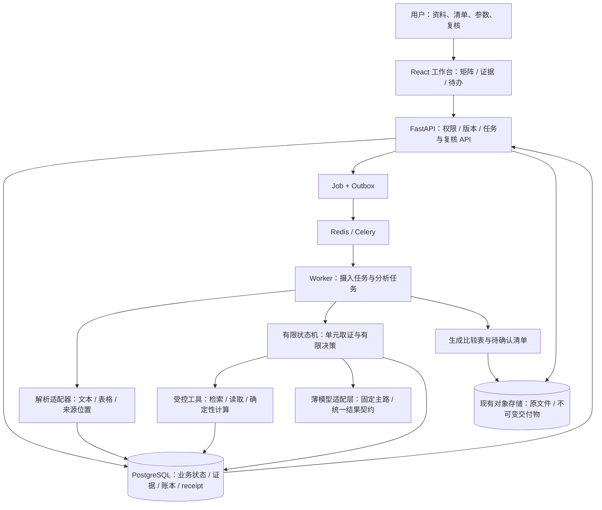
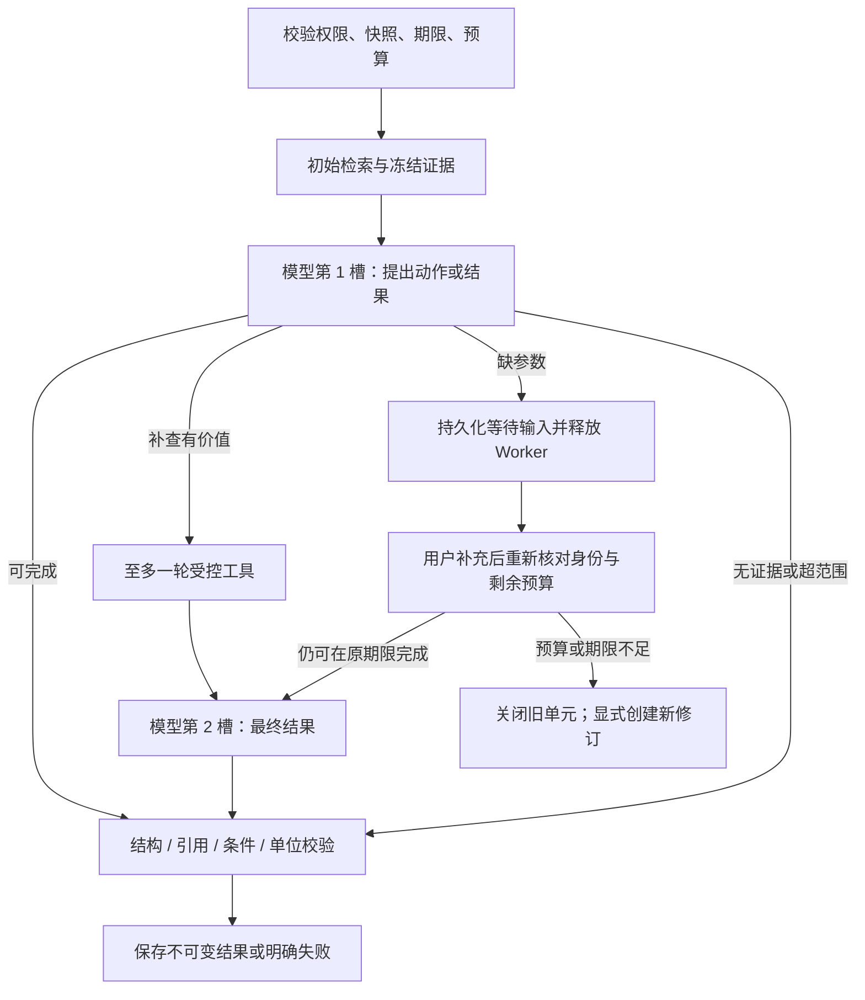

# 多文档审阅与对比工作台技术架构

日期：2026-10-11。版本：已批准设计 v1；2026-10-13 开发切片记录见第 16–19 节。状态：本地工程候选，尚未部署。
需求：[prd.md](prd.md)。实施与验收：[implement.md](implement.md)。

本设计承接用户选择的“多文档审阅与对比工作台”，取代旧商业路线中“售前问卷必须作为主线”的优先级决定。旧功能、历史证据、调用额度及已批准资源限制继续有效。本文件是后续技术设计的唯一主文档；旧问卷路线保留为历史。

## 1. 结论与首个任务

采用 **模块化单体 + API/Worker 进程分工 + PostgreSQL 回执驱动的单 Agent 有限工具循环**。模型负责在取证过程中选择下一步；程序负责来源权限、任务分解、执行预算、计算校验、恢复、审核和交付。当前分支用显式有限状态机完成 A3；LangGraph 仅保留为复杂度证明有收益后的可选编排替换。先完成一个受控的端到端任务，再依据评测增加自主性。

首个任务：一份需求清单与三家供应商的方案、报价、补充条款，按约十个字段完成对照，交付比较表、证据索引和待确认清单。用户审核后用于决策。供应商分组和分析清单由用户确认，不让模型猜测身份或自动决定采购。

五个交互区：项目资料 → 分析清单 → 结果矩阵 → 原文/差异复核 → 导出与版本更新。通用聊天仅作辅助，不成为任务结果的唯一容器。体育背景以后可以作为另一资料包验证迁移，不改变核心业务模型。

### 1.1 “正规 Agent”在此项目中的含义

成熟研发通常先定义可验收任务，再给模型受控工具、持久状态和停止条件，使用真实任务评测，最后完成审阅与运维闭环。不存在所有产品都遵循的唯一框架，也不能由竞品界面推断其内部技术栈。[S1][S4]

| 要素 | 本项目的具体实现决定 |
| --- | --- |
| 目标 | 对指定来源集合逐字段取证、比较并形成可交付矩阵 |
| 环境 | 租户授权的版本化文档和用户明确提供的参数 |
| 规划 | 确定性展开对象 × 字段、依赖排序；首版无需额外 LLM 规划调用 |
| 观察与行动 | 模型可选择完成、补检索/读取、请求参数或停止；工具结果回到下一次判断 |
| 记忆 | 本次运行的固定来源与证据；经明确批准的模板/用户参数。首版无跨租户长时记忆或自动学习答案 |
| 执行控制 | 显式有限状态机；PostgreSQL 业务状态权威；限额、时限、取消和幂等由代码执行 |
| 人审 | 原始结果不可改写，人工修订形成新版本；发布绑定精确交付物 |
| 评测与维护 | 解析、证据到达、事实/条件、计算、任务恢复、完整用户时间分别衡量 |

这是带有限自主取证的领域 Agent。其自主范围刻意较小，不应宣传为能自由处理任意办公任务的通用 Agent。

## 2. 架构与进程



图中模块不是新增独立服务。保留当前 API、Worker、MCP 及既有部署组件；不添加第二个数据库、向量数据库、独立 Agent 平台或网关进程。Redis 传递通知，丢消息可由 Outbox 恢复；不能承担业务结果的唯一存储。

4C4G 是已接受的部署约束，不是此新功能的容量证明。起步候选限制：全系统最多一个活跃 LLM 请求、一个文档解析任务；排队允许，其并发和内存峰值需在目标机器上验收后才能放宽。长调用不占用 API 请求线程，等待用户不占 Worker lease。

### 2.1 选型与复用

| 层 | 选择 | 理由和边界 |
| --- | --- | --- |
| 前端 | 现有 React / TypeScript / TanStack Query / Zod | 新建 analysis 功能区，复用身份、上传、任务进度和界面组件 |
| API/领域 | FastAPI / Pydantic / SQLAlchemy / Alembic | 新增 analysis 领域，不把比较对象伪装成售前问题 |
| 编排 | Core 显式有限状态机 + PostgreSQL receipts | 直接复用 Job/lease/fencing；分支复杂度证明需要前不增加 Pi、CrewAI、LangGraph checkpoint 或新多 Agent 平台 |
| 异步任务 | 现有 Job / Outbox / Redis / Celery | 复用 lease、heartbeat、fencing 与取消；新增 analysis 任务 handler |
| 搜索 | 现有 PostgreSQL tsvector + pgvector / Haystack | 增加来源集合过滤与结构定位；先评估证据到达，再决定 reranker |
| 解析 | pypdf、python-docx、openpyxl 的版本化适配器 | 使用现有依赖做支持范围内解析；Docling/OCR 留作可替换适配器，需单独资源与质量验证 |
| 模型接入 | 现有薄适配器 + 统一业务协议 | 接入层不承担审批、任务、计费或领域推理；不扩建自研网关 |
| 导出 | openpyxl 生成新工作簿 | 新矩阵交付与旧问卷原表回填分别维护 |
| 运维/评测 | 现有日志、OTel/Prometheus、测试与评测入口 | 新增任务维度及错误分类；首版不加另一套常驻观测服务 |

LiteLLM SDK 可在后续接入切片内做最多两天的兼容验证，但不成为架构成立或首个闭环的前置。仅当统一异常、协议或 usage 明确减少维护时采用；关闭 SDK/代理隐式重试。若当前渠道不兼容，继续现有薄适配器。最终只有一个业务层拥有重试决策。

## 3. 当前代码事实与适配缺口

以下是本轮读取的工作区源码，不等于当前线上运行验证；HEAD 为 `31bc30fb7d65fc763fcb45fe5bd1b1c5ff73d062`，已有大量未提交改动。

| 本地证据 | 已有行为 | 处理 |
| --- | --- | --- |
| documents/ingestion.py:101、140、163 | DOCX 主要正文段落；PDF 文本层；TXT/DOCX/PDF dispatch | 扩展结构化解析；不能宣传已有完整表格、OCR 或通用 XLSX 分析 |
| documents/models.py:119、176、257 | 原文件版本、解析/embedding generation、chunk 与偏移 | 复用版本，增 blocks/定位映射与解析覆盖报告 |
| agents/graph.py:356 | 固定 retrieve→generate→validate→draft→approval/publish | 新增 analysis graph，不改变旧运行图语义 |
| agents/tools.py:115 | 原 MCP 五工具 | 维持旧协议；新 analysis 工具契约分开版本化 |
| jobs/service.py:529、646、818、1000 | JobRuntimeService、lease/fencing、heartbeat | 直接复用机制，analysis 状态更新同事务检查租约和取消 |
| billing/provider_calls.py:66 | dispatch intent、每日/operation 原子检查、guard | 复用派发账本；补逻辑步骤到 receipt 的原子关联与 run 预算 guard |
| billing/product_usage.py:57、156、199 | 权益预留、结算、同事务 finish | 复用，新增分析业务指标需迁移与套餐映射 |
| agents/models.py:302、428 | ApprovalRequest/AgentArtifact 均有非空单 document_version 外键 | 无法直接表达多来源；新增分析审批/产物模型，复用底层权限与存储服务 |
| presales/policy.py:40 | v1 要求 route 数量等于派发上限，route 名唯一，最多 2 | 单主路两次不能直接塞入旧 v1；analysis 使用独立策略版本 |
| api/agents/router.py:328 | 带 Last-Event-ID 和授权检查的 SSE | 复用传输模式；analysis 使用自身事件流和租户检查 |

代码路径相对 `packages/core/src/enterprise_doc_core/`；API 路径完整见证据索引。上述“复用”是边界选择，不是无需适配即可通过验收的保证。旧产物、人审表和五工具契约继续服务旧任务，不为新功能放松旧安全不变量。

## 4. 文档与证据：先保留结构，再做检索

### 4.1 统一解析输出

每个解析 generation 产生 `ParsedDocument`：

- 身份：tenant、document_version、文件 SHA-256、parser/chunker 版本、generation。
- `blocks`：paragraph、heading、table、table_cell，保留原始顺序、父子关系、文本与规范化文本。
- `locator`：PDF page + text span；DOCX 段落/表格/行列/部件；XLSX sheet + A1/range；TXT 行范围。
- `coverage`：已读取的页/部件/工作表、已知未支持元素、错误与完整性未知项。
- `block_hash` 和规范化偏移映射：能够从 chunk 中引用回到确定版本的 block，而不依靠模型生成页码。

检索 chunk 是索引单位，block/表格单元格是引用单位；chunk 必须记录一对多 block span。generation 更换后旧定位保留，不重新解释旧偏移。PDF 首版仅承诺页码与文本引用；没有可靠 bbox 时不伪造高亮框。DOCX 不承诺稳定分页，显示段落及表格坐标。

| 格式 | 首版支持与限制 |
| --- | --- |
| TXT | 显式编码验证、行号和文字范围 |
| PDF | 可提取文本层，逐页检查。无文本页标记 needs_ocr；混合/复杂布局为 partial 或 unknown，不以非空文本宣称覆盖完整 |
| DOCX | 按正文顺序遍历段落与表格，保存表头、合并单元格、行列；页眉页脚可独立部件读取。图片、嵌入对象、无法可靠展开的修订/文本框必须告知 |
| XLSX | 只读值、公式字符串、已有缓存结果、单位格式、表头、合并范围与隐藏属性；隐藏表/行不静默遗漏。无缓存或依赖外部数据的公式标为 unavailable/unverified |
| 其他 | 扫描件 OCR、PPTX、DOC、XLS、XLSM、加密文件及任意脚本执行不进入首版 |

openpyxl 不能重新计算公式。公式缓存即使存在也可能过期，不能直接成为“已验证价格”；需用户明确确认或从可验证输入用白名单公式重算。首版不启动 Excel/LibreOffice，不执行宏、外部链接或文件中的命令。

上传入口验证类型、解压膨胀、路径和规模，解析在受限子进程中执行并清理本次 spool。首版候选上限为 10 份文件、每份最多 10 MiB、100 页或 20,000 个非空表格单元格；取这些上限与现有上传/租户限制的更小值。解析超时/内存预算为必填部署配置，在目标资源上测量后冻结。此处数字是开发限制，不是容量/SLO，不能据此提高已批准额度。

### 4.2 来源分组、检索和“没找到”

用户明确指定 `common_requirements` 与每个 `object_id` 的资料组。共同需求是判断标准，不能充当某供应商已经满足标准的证据；不同供应商资料不能互相证明。每条请求 server-side 加 tenant、可访问来源版本、generation 与 object scope。

初始取证按模板字段的关键词、表头和查询提示检索，结合邻近段落/完整表头。有限补检索仍在同一来源集合内。首版不启用自动网页搜索，上传资料中的提示不得获得执行权限。

分别记录：

1. 解析覆盖：本应读取的内容是否可靠解析；
2. 检索覆盖：实际搜索/读取过哪些来源与定位；
3. 证据支持：证据是否支持这个值、限定条件和比较结论。

top-k 没有命中只能表达“在此次已检索范围中未找到”，不能断言整个文件没有该事实，更不能得出“不符合”。文档的新版本或新增附件可能改变这个结论，因此即使没有引用，缺失结果也要依赖其被搜索的来源范围。

## 5. 领域模型与版本关系

### 5.1 最小持久模型

下表是完整目标模型。迁移 `0039` 已实现 project/source snapshot，`0040`
已实现 run、unit、action、首个 cell revision 与 event，`0041` 已实现 input request
与 tool receipt，`0042` 已实现 reviews/artifacts/approvals 与后续 revision，`0043`
已实现 dependencies、base-run/reuse lineage 和 freshness。证据集目前冻结在 unit/cell
的类型化 JSONB 中。对象分组、字段定义和参数存入
有严格 schema 与大小限制的 draft/frozen JSONB；只有执行、恢复和授权需要的关系
先关系化，避免为了十个字段拆出大量配置表。

| 模型 | 关键字段与关系 |
| --- | --- |
| analysis_projects | tenant、owner、title、draft_spec、draft_revision、created_at；ETag 乐观并发 |
| analysis_runs | project、immutable input_snapshot、snapshot_hash、policy/route/prompt/tool/parser versions、status、deadline、budget、cancel_requested |
| analysis_units | run、object_id、field_id、input_fingerprint、execution_status、step、attempts；同 run/object/field 唯一 |
| analysis_cell_revisions | unit、revision、typed_value、conditions、evidence_state、comparison_state、author_type、supersedes、created_at；不可变 |
| analysis_evidence | cell revision、version/generation/block/span、quote_hash、authorized evidence-set id；校验前不能成为正式引用 |
| analysis_dependencies | cell revision → source scope/version、field revision、parameter revision、upstream cell revision；用于保守失效 |
| analysis_actions | unit、logical_step、attempt、kind、request_fingerprint、status、provider_dispatch_id 或 tool result 引用；唯一键阻止恢复时重复执行 |
| analysis_input_requests | unit、revision、参数名/单位、状态、提交值 hash、提交人/时间；同 unit revision 唯一 |
| analysis_tool_executions | unit、ordinal、白名单工具、request fingerprint、状态、result hash/error；同 unit 至多三个 ordinal |
| analysis_reviews | cell revision、actor、approve/change/reject、理由、时间；人工修订产生新 cell revision |
| analysis_artifacts | run、matrix_revision、cell_revision_ids、source_manifest_hash、content_hash、format、status、私有对象存储定位 |
| analysis_approvals | artifact id/hash、source_manifest_hash、matrix_revision、operation、actor、expires_at、decision、consumed_at |
| analysis_events | run、递增 sequence、事件类型、白名单 public payload；支撑 SSE 断点读取 |
| document_blocks / chunk_block_spans | 在 documents 领域增加结构与引用映射；generation 关联解析覆盖清单 |

所有跨表身份含 tenant；涉及来源或结果关系使用复合唯一键/外键或等效的事务校验，不能只信客户端 UUID。冻结 input_snapshot 包含有序对象、全部来源版本/generation/hash、字段 schema、用户参数及其来源，序列化规则版本化。

不把新分析结果伪装进旧 AgentRun 的一个主文档版本，不设“第一份文档代表整个资料包”的捷径。新模型沿用审计、身份、Job 和对象存储服务；需要共享的小型基础函数才抽取，避免复制整套服务层。

### 5.2 字段与结果契约

字段定义至少有：id、名称、类型、问题/比较标准、适用条件、允许单位、必需参数、搜索提示、上游字段、计算规则。首版类型：text、boolean、decimal、money、date、duration、enum、list。模板依赖必须是 DAG，拒绝循环。

结果示意：

```json
{
  "field_id": "annual_cost",
  "value": null,
  "value_type": "money",
  "conditions": ["报价按用户每月计价；税费口径未说明"],
  "evidence_state": "insufficient",
  "comparison_state": "not_comparable",
  "missing_parameters": ["用户数量", "税费口径"],
  "claims": [{"text": "计费周期为每月", "evidence_ids": ["ev_1"]}]
}
```

金额用 decimal 字符串与 ISO currency，时间保留单位和起算事件。未说明税率、汇率、数量或起算日期时不补造；本地计算结果必须有 formula_version、输入 cell revision/用户参数、单位、舍入规则和完整公式记录。

状态正交：

| 维度 | 值及含义 |
| --- | --- |
| 执行 | queued / running / waiting_input / succeeded / failed / cancelled / expired |
| 证据 | supported / conflicting / insufficient / unreadable |
| 审核 | unreviewed / approved / changes_requested；从具体 revision 的审核记录推导 |
| 比较 | comparable / not_comparable / not_applicable |
| 新鲜度 | current / stale；相对于目标资料/参数快照计算 |

`succeeded + insufficient` 可以表示正确完成检查并给出可行动缺口，不等于已回答所有问题。`failed` 没有合法模型结果，不能冒充缺证据。缺失值与 false 不同；not_applicable 必须有明确规则和原因。冲突保留两侧证据，文件上传时间不能自动决定谁覆盖谁。若采用优先条款，需记录有依据的优先规则或用户确认。

## 6. 工作流与 Agent 决策

### 6.1 运行拆解

项目 draft → 固定来源/字段/参数 → admission → 生成每对象每字段 unit → 单元图执行 → 聚合矩阵 → 人工复核 → 生成交付物 → 精确版本批准。

单元是工作与恢复的最小粒度，队列消息仅带租户安全的内部 ID。MVP Worker 顺序处理；将来并发可增加，但不能改变单位预算与结果语义。衍生计算字段由依赖排序调度，完全可确定计算的字段不调用模型。



图省略的异常边统一由策略处理：第一次派发发生可重试故障时第二槽用于同主路重试；第二次还失败则终止。若第二槽返回工具请求、损坏协议或不合格引用，拒绝该结果，无第三次修复。若第一次故障后的第二槽提出需要再次观察的工具动作，也只能转待确认，不能偷偷调用第三次。

等待输入节点本身不包含模型调用、扣量或发布。恢复从节点开头重跑也只能做幂等 DB 检查。[S2] 若工具阶段发现缺参数，以同一规则暂停；剩余槽与原执行期限不重置。

### 6.2 模型动作协议

首轮输出经 Pydantic discriminated union 校验：

- `final`：候选 cell result；
- `tools`：至多三个白名单操作的有界列表；
- `need_input`：列出允许询问的缺失参数与原因；
- `abstain`：给出缺证据/不可读/不适用的具体原因和已查范围。

第二轮仅接受 final、need_input、abstain，不允许再开工具循环。工具调用来自结构化协议，不解析自由文字为代码。provider adapter 把不同传输协议规范为同一业务 schema；供应商原生 function calling 是可选传输能力，不作为唯一实现前提。

模型可自主改变检索词、选择允许来源/位置、识别需确认参数及决定停止；不能新增供应商、扩大授权、批准结果、改预算或向外发送文件。任务分解和生成工作簿由代码处理。

### 6.3 工具边界与 MCP

| 工具（拟议名称） | 输入/输出 | 控制 |
| --- | --- | --- |
| search_sources | scope + query + field hints → 有界命中、表头/邻近窗口、来源定位及覆盖摘要 | server 固定 scope；最多 8 个返回证据块，总上下文上限 |
| read_source | 已授权 version/generation 与 locator → 有界文字/表格区域 | 不接受任意路径/URL；定位不存在返回 typed error |
| calculate | operation enum + 带单位/来源的 operands → Decimal 结果与算式 | 仅 sum/product/unit_conversion/explicit_period_total 等白名单，无 eval 或任意 Python |

工具在当前 Worker 内通过类型化 registry 调用同一 Core 服务；复用服务端授权与审计，不必为本进程内部调用再增加一个 MCP 网络往返。现有 stdio MCP 五工具契约保持；未来需开放 analysis MCP 时另设版本化 capability/schema，走相同 dispatcher，不创建第二套权限逻辑。

一次工具轮内最多三个操作，按预算串行执行，可为不同来源的独立补查。search_sources 返回可直接使用的有界原文窗口，减少“搜到 ID 还需第三次模型决定读”的依赖；若仍需更深链条，首版停止并列待办。计算一般作为结构化字段后的确定性步骤；模型也可选择 calculate，但它不能决定未知税率或单位转换假设。

各工具统一 request fingerprint、授权 scope、输出字节上限、超时、receipt 和 allowlisted error。工具调用次数与 LLM dispatch 分开计量；搜索所需 embedding 仍受其自身账本约束，不属于免费隐含步骤。

## 7. 模型契约、预算与失败

### 7.1 固定主路

固定路径命名 `analysis.execution.v1`，Agent 路径命名 `analysis.execution.v2`；二者持久保存 route identity、model/revision（若上游提供）、prompt/schema/tool 版本、deadline、输入/输出限制、最大派发、工具轮数、重试分类及预算。

首版沿用此前选定的 GPT 主路作为候选，不静默转到 Grok。具体端点能力、当前线上身份和模型修订在实施前只读核验；历史记录里的模型名不能代替实时契约测试。不同模型即使 JSON 相同，语义也未必等价；替代模型须独立评测、显式切换新任务，旧任务保持冻结路由。

### 7.2 一处负责预算和重试

| 项目 | 首版上限/规则 |
| --- | --- |
| LLM 派发 | 每个 unit 最多 2 次，首答、工具后回答、传输重试、任何付费修复共用 |
| 自主工具 | 最多 1 轮、3 次调用；每次均有限时与输出上限 |
| 矩阵 | 最多 3 对象 × 10 字段；最坏 60 次 LLM dispatch，确定性字段/直接完成通常更少 |
| 每日 | 保留既有每日 200 次生成边界；还须满足现行 provider 的更严格聚合限额、租户权益与余量 |
| 上下文/期限 | 在策略中冻结；不得高于已批准路由限制；缺配置拒绝 admission，不能用 SDK 默认值 |
| 隐含调用 | 关闭 SDK/HTTP/框架自动重试及模型自修复；原适配器内部 repair 必须纳入同一预算或关闭 |
| 重启/再次点击 | 不能清空 attempts；相同幂等键返回原 run；人工创建新修订仍计入当日用量 |

60 是整表最坏请求估算，不是本轮授权发起 60 次真实调用。创建 run 前显示最大派发和预期范围，检查实际当日余量；任何评测/诊断共用已有生成边界，embedding 和已采用的 provider 聚合限额继续执行，不通过新 kind 绕过。

沿用 `ProviderCallService` 的业务锁 → daily → operation 锁顺序。每个模型 unit 可使用现有 `kind=agent, operation_id=unit_id`，新增 run guard 统计整表预算，不重用单一 run_id 使所有字段共享两槽。admission 预检查不保证未来余量；每次 dispatch 在同一事务重查 unit/run/每日预算并写 intent。其他任务消耗余量时，剩余单元可见地停止为 budget_exhausted，不越限完成。

ProviderDispatch 与逻辑 action 的关联已在 A2 通过
`ProviderCallService.scope(..., intent_link=...)` 同事务写入；`0040` 的复合外键
绑定 tenant、unit operation 与 dispatch，唯一约束绑定 unit/slot。网络发送只在该
事务提交后发生；不得退回“guard 成功后发送，再补写 intent”。

### 7.3 异常矩阵

| 观察到的情况 | 行为 |
| --- | --- |
| 明确 429/允许的 502、503、504/发送前连接失败 | 剩余槽与期限允许时同主路至多再派发一次；尊重有界 Retry-After/退避 |
| 401/403、无效请求、模型不支持契约 | 终止，展示可行动错误，操作侧修配置；不重试 |
| 完整输出语义错、越权引用、schema 不符 | 保存失败类别/受保护原始候选，不重复抽样直至通过 |
| 超时、半截流、连接在发送后中断、进程崩溃且无回执 | 保留 dispatched/unknown 成本，停止自动重发；如 provider 有已验证的状态查询/幂等能力可先对账 |
| 原文证据不足或用户参数缺失 | 受控补查或 waiting_input；不按传输错误重试 |
| 用户取消、权限撤销、lease 失效 | 停止新调用，迟到响应不能更新业务结果；已产生外部成本保留 |
| 第二次失败或达到单元期限 | failed/expired，其他单元继续，用户可复核已完成部分或人工补写 |

重试能改善部分短暂故障，不能保证主渠道可靠，也不能修复协议或语义问题。未知派发不能当作未调用；也不声称外部 HTTP exactly-once。

## 8. 持久执行、恢复与取消

PostgreSQL 中的 run/unit/action/tool/input/result/approval 是事实来源。当前实现不创建 LangGraph checkpoint；若后续采用编排框架，checkpoint 也只能保存 IDs、当前 step、剩余预算引用、证据集/快照 hash 等小状态。[S3] 不把文件全文和全部模型历史无限放入编排状态；受保护证据与模型原始输出如需留存，使用受控存储、大小与保留期限，公开事件不得含这些正文。

执行顺序：

1. API 在一事务写 run、unit、权益 reservation、Job、Outbox 和初始事件；HTTP 返回 202 + run_id。
2. Worker claim 后带 fencing_token 进入 unit；每个状态写入及派发 guard 都验证当前租约、取消、权限、快照和期限。
3. 工具/模型执行先查 action 唯一键。已有完整 receipt 与持久结果时重放结果，不重新调用。
4. 外部调用前提交 intent；成功返回后保存校验所需输出/结果引用，再推进持久状态。状态落后时从业务 receipt 恢复。
5. intent 已提交但结果未持久化的窗口按 unknown 处理；不能凭“状态还没前进”再次派发。
6. unit 结果与业务用量 settle/release 在同一事务完成，终态幂等；导出、重连、重新下载不重新计量。
7. waiting_input 保存后结束本次 Job，释放 lease；用户输入通过权限、ETag、快照/期限校验后生成恢复 Job。暂停不会长期保留 Worker 或延长旧审批有效期。
8. 取消先持久化标志，阻止后续派发；进行中的 HTTP 尽力取消，可能已收费的请求留账。已完成其他单元不丢失。

run 状态为 queued / running / waiting_input / completed / partial / failed / cancelled / expired。它是单元汇总的执行状态，不能等同于“全表已审核”：有可调度工作为 running；无可调度且有等输入单元为 waiting_input；全部成功为 completed；成功与失败/弃置混合为 partial；无成功且无等待为 failed（取消/过期原因优先显示）。草稿可以在运行中查看；审核状态单独显示。

业务权益暂定义为“产生一个合法分析结果的单元”，同 unit 最多结算一次；正确且可行动的 insufficient 可以是合法结果。解析/传输失败和人工补写不伪装成模型成功；无结果释放 reservation。用户输入改变导致新 unit 时明确显示这是新分析，不借恢复隐藏额外计量。此指标需在受邀套餐映射与 UI 说明完成后才启用商业扣量，不能把旧问卷指标静默映射到新产品。

## 9. 审阅、交付与增量更新

### 9.1 审阅和交付

每个事实/条件关联引用；证据面板展示原文件版本、定位、必要前后文和解析限制。人可以保留未知、修正内容或确认结果；修订记录作者、时间、理由和前后版本，模型原稿不可覆写。无文档依据的人工补写标记为“用户提供”，不能伪造为原文结论。

工作簿固定包含：比较表、待确认项、来源与计算依据。导出时防 spreadsheet formula injection，原文以文字写入；交付计算值来自服务器确定性工具，首版不依赖客户打开文件才能得到正确值。

首版允许两种交付：

- 草稿：有权限的项目成员可下载，显示未审核、冲突/缺失/失败数量以及生成时点。
- 复核稿：选定范围内每个结果版本和待确认处置都已被明确复核，绑定不可变 matrix revision；未解决问题可保留，但必须在交付中可见，不能称全部满足。

内部“发布”指将精确文件版本标为批准交付，并不向第三方发送。沿用 active owner 发布规则，审批必须匹配 artifact hash + source manifest hash + matrix revision + operation + expiry；文件改变后原审批不再匹配。审批 node 不重新执行模型。

首版整份矩阵采取保守的权限交集：用户必须可访问所有绑定来源，才能查看全表或下载。撤销任一来源权限后阻止新查看/下载与发布；仍保留受保护历史。已下载文件无法远程收回，此限制在权限说明中明确。

### 9.2 增量更新与保守失效

替换文件不修改既有 run。创建新快照，通过依赖图决定重算：

- 用户数量/期间变化：相关费用计算失效，证据抽取无需重复调用；
- 某单元人工修订：下游计算/比较失效，其他抽取保留；
- 某字段定义变化：该字段及下游失效；
- 某供应商来源更新/新增附件：该对象所有依赖该检索范围的字段失效，包括先前“未找到”和未引用该文件的结果；
- 共同需求变化：所有引用它或依据其比较标准的字段失效；
- 权限撤销：立刻阻止访问；不能等重算后才生效。

MVP 的文件级变化采用保守失效，不声称能精确知道一份新文件不会影响未引用它的结论。跨快照复用需要身份、generation、字段、参数及依赖 fingerprint 全部匹配；新来源的旧审批不自动继承。可以显示“上次已审核”作为参考，但当前批准绑定当前版本。

## 10. API 与前端边界

沿用项目的错误 envelope、身份依赖、幂等与分页规范。下表接口均已在本地候选实现；
feature flag 默认关闭且未部署，不等于生产可调用。

| 状态 | 接口 | 行为与关键控制 |
| --- | --- | --- |
| 已实现 | GET /api/analysis/capabilities | 返回资料与执行两个开关的实际可用状态 |
| 已实现 | GET/POST /api/analysis/projects | 列出/建立项目草稿，不触发模型 |
| 已实现 | GET/PATCH /api/analysis/projects/{id} | 查询/更新分组、字段、参数；If-Match 防覆盖 |
| 已实现 | POST/GET /api/analysis/projects/{id}/snapshots | 确认/列出不可变来源快照；确认要求 If-Match |
| 已实现 | GET /api/analysis/snapshots/{id}/sources/{version_id}/blocks | 重新检查项目与全部来源权限，返回有界原文/定位 |
| 已实现 | POST /api/analysis/projects/{id}/runs | 对已确认 snapshot 做 admission、幂等创建；202；显式 fixed/agent，同 key 不可换 snapshot 或 mode |
| 已实现 | GET /api/analysis/projects/{id}/runs | 列出仍对当前 actor 完整可见的历史 run |
| 已实现 | GET /api/analysis/runs/{id} | 状态、派发计数、完整分母与取消状态 |
| 已实现 | GET /api/analysis/runs/{id}/matrix | unit/cell 状态、引用、检索范围与错误；服务端事实来源 |
| 已实现 | GET /api/analysis/runs/{id}/events | 有限 SSE + Last-Event-ID；公开白名单，重连只读 |
| 已实现 | POST /api/analysis/runs/{id}/cancel | 幂等取消，禁止新派发并释放未完成权益 |
| 已实现 | POST /api/analysis/runs/{id}/inputs | 明确 input request id + expected revision；严格参数集合；同值幂等；只恢复仍有效待输入单元 |
| 已实现 | POST /api/analysis/cells/{id}/revisions | 人工修改生成新版本，If-Match，绑定用户提供内容 |
| 已实现 | POST /api/analysis/cells/{id}/reviews | 审批精确 cell revision；过期版本返回冲突 |
| 已实现 | POST /api/analysis/runs/{id}/exports | 冻结 matrix revision 与完整范围，生成草稿/复核稿 |
| 已实现 | POST /api/analysis/artifacts/{id}/approvals | 精确交付物确认，由有权用户发起；不触发模型 |
| 已实现 | GET /api/analysis/artifacts/{id}/download | 核对最新权限、文件身份和交付状态 |

事件如 unit.started、unit.completed、input.required、run.partial、export.ready；只携带安全 ID、数量、阶段及 allowlisted code。结果正文由专门授权 API 获取，不把原文、模型推理、prompt、endpoint、对象 key 或签名 URL 放进 SSE/日志/指标标签。

客户端 SSE 丢失后以矩阵 GET 对账，服务端真相优先；不因刷新页面创建新 run。
A3 React 页面当前使用 GET polling，尚未接 EventSource。前端展示“正在查资料/
需补充数量/该项失败”等业务状态，模型通道与协议版本只在诊断中出现。

## 11. 模块落点与依赖方向

建议新增：

```text
packages/core/src/enterprise_doc_core/
  analysis/
    models.py, schemas.py, service.py, policy.py
    graph.py, tools.py, evidence.py, calculations.py
    review.py, export.py, dependencies.py
  documents/
    parsing/                 # 版本化适配器与 canonical blocks
apps/api/src/enterprise_doc_api/analysis/router.py
apps/worker/src/enterprise_doc_worker/analysis_handler.py
apps/web/src/features/analysis/
tests/analysis/
```

文件名为实施切分建议，允许按现有规范减少文件；不是要在本轮创建空壳。API/Worker 调用 Core；Core 不导入 Web/HTTP UI；工具调用领域服务，不能反向调用自己的公网 API。新路由挂 feature flag，旧 presales 路由继续可用。

analysis 可复用 documents、jobs、billing、auth、audit、object_store 的公共契约，不依赖 presales 私有模型。共享 gateway 的通用结构输出边界可抽取，问卷特有 prompt/repair 不能直接套到分析结果。

## 12. 验收、泛化和维护

### 12.1 先冻结评测任务，再调试

首轮资料与任务按“独立供应商/来源包”分组，开发、验证、留出之间不复用同一原文件或模板变体。暂定 3 包开发、1 包验证、2 包留出，每包约 30 个矩阵单元；这是待准备规模，不是已有真实用户或自动运行全部请求的授权。来源可用性不足时先报告缺口，不把合成案例冒充真实报价。

扩展场景可包含服务方案、软件报价及体育/队服采购，用于发现字段模型是否过拟合；不同时做行业专用产品。过去已用于调参的资料只作开发/回归。数字/单位替换、删证据、矛盾版本、扫描页和恶意指令是明确标注的变形用例。

对照分两层：

1. 工程对照：同模型、同资料、同预算，固定检索一次回答 vs 有限自主补查；单独衡量工具循环价值。
2. 产品对照：完整人工流程及能获得的现成多文档成表工具；包含上传、提示调整、复核、补料、导出时间。不以未实际访问竞品的情况填实测值。

### 12.2 首轮候选门槛

下列为预先设定的验收目标，尚未达到；报告 n/N、失败与未运行项，不只统计成功输出。

| 方面 | 首轮目标/记录 |
| --- | --- |
| 解析与引用 | 支持用例的关键表格/字段定位全部可追溯；不支持内容全部显式提示；越权与错误版本引用 0 |
| 事实与口径 | 无需实质事实/条件修改的单元 ≥80%；虚构价格/税率、跨对象归属、把未知当满足等严重错误 0 |
| 缺失/冲突 | 正确保留已标注缺口与冲突 ≥90%；充分证据题另报覆盖率，不能全部弃答过关 |
| 计算 | 冻结的白名单算术、单位、舍入与未知前提测试全部通过 |
| 恢复与账本 | kill/replay/cancel/SSE 重连不重复业务结算、不超预算；未知外呼可见 |
| Agent 增益 | 工具动作可解释地补到关键证据；与固定流程比较修订量、延迟、真实用量，成本不明单列 |
| 产品价值 | 独立试用比较完整人工时间与严重错误、再次使用行为；当前参与者 0，只能先备齐材料 |

引用逐字合法不等于语义正确，模型自评分不是放行依据。确定性校验负责身份、范围、类型、引文、算式；语义/条件仍需标注参考与人审。助手审查属于开发验证，不充当独立客户验收。[S4]

每轮只改变一个主要因素（解析、召回、协议或循环），保留候选版本和完整分母。连续两个候选没有改善主要错误或审阅时间，回到任务/材料诊断，不增加 Agent 数量或无限真实重试。

### 12.3 运维信号

记录 run/unit/action/dispatch 的关联 ID、冻结版本、阶段耗时、队列时间、解析部分失败、证据缺口、人工修订比例、预算耗尽、未知外呼及 artifact 状态。敏感正文不进入通用日志。

全表和单元分别记录 p50/p95、失败分布、LLM/embedding 用量、估算/实际/未知成本及用户人工时间。小样本不承诺 p95 稳定性；首次目标资源测试后才设置容量与等待时间 SLO。

## 13. 迁移、发布与回滚

1. additive migration 增加 analysis 表及 document block 索引；旧解析输出和旧 artifact 可继续读取。
2. 新 parser generation 不覆盖旧 generation；已冻结证据引用的 generation 必须保留，不能在 reindex 时级联删除。
3. 先实现离线/受控 HTTP 与真实 PostgreSQL 行为测试，再 feature flag 下启用内部试用。
4. analysis 与旧 presales 各自冻结策略，不能用修改旧 v1 枚举的方式切断历史恢复。
5. 回滚先关闭新任务 admission；已运行任务由兼容 Worker 排空或取消，保留多来源审批、账本及结果读取。
6. 新数据产生后不执行破坏性 down migration，也不直接回退到无法识别新 job kind/schema 的旧二进制；准备兼容回退版本。
7. 复用现有单节点部署、恢复演练与发布门槛；新设计没有补齐 HA、独立灾备或商业客户验证，不能替代这些门槛。

## 14. 开发顺序与本轮边界

工作包与命令详见 implement.md：

- A0：冻结首个输入/输出任务、模板、解析支持清单与失败类别；
- A1：结构化解析、证据定位、资料分组与来源快照；
- A2：一份可审阅矩阵的固定取证闭环，加入单主路预算和持久恢复；
- A3：接入一轮自主补查/确定性计算并做固定流程对照；
- A4：人审、交付、参数/资料更新、版本失效与兼容发布；
- A5：独立留出、目标资源验收和试用材料；真实客户反馈单列等待。

A2 先让最窄切片产生实际产物，A3 再测量自主循环是否有收益，避免先写一套通用工具平台。预算、权限与幂等不能延期到最后。每个包都有可观察结果及退出条件，不以写完目录结构表示完成。

2026-10-11 架构评审轮只创建规划任务、PRD、设计、实施清单和来源索引，并给旧路线加导航。随后用户批准实现，任务已启动；本段为评审轮历史边界，当前实施状态见第 16 节和 implement.md。

## 15. 依据与限制

[S1] [Anthropic: Building effective agents](https://www.anthropic.com/engineering/building-effective-agents)：工作流与动态工具选择的区别、从最简单可行方式开始。用于模式判断，不证明本项目收益。

[S2] [LangGraph: Interrupts](https://docs.langchain.com/oss/python/langgraph/interrupts)：中断恢复会从节点开头重跑，副作用须幂等。官网部分新示例不代表当前依赖支持全部 API，实施以锁定版本与既有机制验证。

[S3] [LangGraph 持久化入口](https://docs.langchain.com/oss/python/langgraph/durable-execution)：本次抓取实际正文为 Persistence 概览，只采用 checkpointer/store 区分，不从该页面推导 exactly-once。

[S4] [Anthropic: Demystifying evals for AI agents](https://www.anthropic.com/engineering/demystifying-evals-for-ai-agents)：按任务、trial、grader 与真实 outcome 评估，避免只凭模型宣称完成。

产品行为参考 [Hebbia Matrix](https://www.hebbia.com/matrix) 与 [V7 Citations](https://www.v7labs.com/changelog/ai-citations)。其内部实现未核实，不将本架构称为竞品同款技术架构。[NotebookLM Data Tables](https://blog.google/innovation-and-ai/models-and-research/google-labs/notebooklm-data-tables/) 已覆盖多文档成表与导出，后续必须以完整任务对照验证差异。

本地约束：[Agent/MCP/HITL 规范](../../spec/backend/agent-mcp-hitl.md)、[现有架构记录](../../../docs/ops/current-architecture-and-config-gap.md)、[旧商业路线与资源边界](../../../docs/ops/commercial-product-roadmap-20261011.md)。旧架构记录有日期与历史运行范围，不作实时线上版本证明。

原始抓取、代码锚点与取舍保存于集中恢复组的 `fallback-model-evidence/document-analysis-architecture-20261011-index.json`。此前市场结论为同目录 `office-agent-market-20261011-decision.md`。本设计选择来自公开技术方法、已检查代码和项目约束，效果仍需后续运行验证。

## 16. A1/A2 实现记录：资料准备与固定取证矩阵（2026-10-12）

已实现独立 analysis project、对象/字段草稿、来源确认快照、授权原文读取，
以及固定检索后单次回答的 run/unit/matrix 执行；React `#/analysis` 页面可完成
资料准备并查看矩阵。A3 输入恢复与 search/read/calculate 工具、A4 人工
revision/review/export/artifact approval 及跨快照保守复用均已实现；生产启用和
外部质量验收仍不属于本地工程候选结论。

实际落点作以下窄化，替代第 4/5/11 节对应的拟议表名：

- canonical blocks 先存为 `document_structures.payload` 中一份经 Pydantic 校验的不可变 JSONB；键为 generation，另存源 hash、payload hash、coverage。旧 chunks 的 offsets 映射到这个规范文本；恢复时逐 chunk 校验，不存在已实现的独立 `document_blocks` / `chunk_block_spans` 表。单块独立查询优化留到真实规模证明需要时再拆。
- `analysis_source_snapshots` 保存项目 revision、字段与对象、所有源版本/generation/hash，`analysis_snapshot_sources` 的复合外键防止跨租户关联并阻止删除已引用 generation。确认同一项目 revision 幂等，项目修改产生下一 revision；它是取证前的资料确认，**不是**产物发布审批或模型执行。
- 当前项目只允许创建者查看/修改，同时每次读取再检查所有来源权限与活跃成员资格。比未来项目成员共享更保守；未引入另一套共享 ACL。
- 统一开关 `UPLOAD__STRUCTURED_DOCUMENTS_ENABLED` 默认 false。开启后所有新完成上传使用 parser 2，接受 XLSX 并收紧到 10 MiB；completion 在 Job payload 固定 `parser_version`。Worker 同时保留 1/2 路由，不读当前开关决定重试解析器。历史没有该键的 Job 仍用 parser 1。切换前先排空在途上传会话，避免让按旧大小策略创建的会话在开启后进入较小的新解析上限。
- 关闭开关拒绝新项目、修改与来源确认，但保留旧快照读取和已入队 parser 2 任务处理。兼容回退必须保留新表/Worker 路由；有结构或分析历史的降级被阻止。
- 解析隔离使用受父进程管理的 `Popen` 与线程管道 I/O，兼容 Windows psycopg Selector loop；超时/取消会 kill 并回收子进程。Linux 地址空间上限候选为 768 MiB，Windows 只验证结构/文件上限与 watchdog，不声称通过 RSS 或 4C4G 生产资源验收。
- `0040` 关系化 run、unit、两槽 action、首个 cell revision 和有限 public event；
  run 创建与所有 `analysis_cell` 预留、Job/Outbox、初始事件同事务完成。正式和
  本地权益 CLI 均可显式配置 analysis quota；省略保持旧 schema/自动化兼容，
  显式 0 表示禁止使用。
- A2 先按字段提示从该对象的冻结来源选择至多 8 个证据窗口，再调用固定主路。
  gateway 自身不重试；只有连接前失败或明确 429/502/503/504 可由持久 executor
  消耗第二槽同路重试。未知发送结果、截断流或无回执重启不自动重发。
- provider intent 与 `analysis_actions` 通过 `intent_link` 同事务绑定后才发送。
  合法结果与一个 `analysis_cell` 结算同事务；失败/取消/过期释放，waiting_input
  暂留。服务端 SSE 支持有限 `Last-Event-ID` 重放，当前 React 仍以 GET polling
  获取矩阵。

确认本地链路：XLSX completion → Job/Outbox → 真实 Worker → PostgreSQL 结构 →
分组快照 → sheet/A1 原文；固定 execution 使用受控 HTTP 走 run → unit → action →
matrix，并验证配额、重试分类、未知外呼、租约接管、取消与恢复。浏览器从真实
API/隔离 PostgreSQL 完成保存、确认、矩阵刷新恢复与窄屏查看。外部对象存储使用
受控实现，embedding 使用本地 hash；没有真实模型输出、公开报价质量或独立客户
效果结论。

## 17. A3 实现记录：有限工具、输入恢复与受控对照（2026-10-12）

- `analysis.execution.v1` / `analysis.fixed.v1` 保持默认；显式 Agent 模式冻结
  `analysis.execution.v2` / `analysis.agent.v1` 和一轮工具预算。Run 响应暴露模式，
  幂等键不能在相同项目内改绑 snapshot 或 mode。
- 首槽允许结构化 `tools`，最多三个 `search_sources` / `read_source` /
  `calculate`；服务器再次校验 scope、locator、单位、Decimal、舍入与 receipt hash。
  第二槽拒绝工具动作，模型重试、工具后回答共用原两槽。
- `analysis_input_requests` 与 `analysis_tool_executions` 由 additive 0041 保存。
  缺参数时完成当前 Job 并保留 reservation；认证输入提交绑定 run/request/unit/tenant、
  revision 和精确参数集，创建唯一恢复 Job。原 deadline 与剩余槽不重置，同值重放
  不产生第三个 Job 或重复工具。
- Web 显式选择 fixed / limited Agent，幂等 key 包含模式；waiting cell 显示带单位
  参数并提交，成功后刷新矩阵并恢复 queued/running polling。Zod 同步校验输入请求、
  calculation ID/receipts 和执行模式。
- 当前编排落点是 `AnalysisExecutionService` 内由 PostgreSQL receipt 驱动的显式有限
  状态机，没有使用 LangGraph checkpoint。它满足本切片的停止、恢复和幂等条件；
  只有后续复杂分支证明能降低维护成本时再迁移框架。
- `a3-comparison.json` 的受控同快照/同 route/model/同两槽案例只证明：fixed 为
  1 次派发、0 工具；Agent 为 2 次派发、1 次工具并终止。计算恢复另证实
  `1200 * 10 * 12 = 144000.00 CNY`、deadline 不变、同值重放不新增 Job。
  真实语义质量、人工修订、真实时延与费用尚未运行，因此不能宣布 Agent 优于固定流程。

## 18. A4 实现记录：精确审阅与冻结交付（2026-10-12）

- additive 0042 扩展不可变 cell revision，并增加 analysis 专属 review、artifact
  与 approval；不复用只绑定单文档的旧 `AgentArtifact`。人工内容标记
  `value_origin=user_provided` 且没有伪造 evidence；审核绑定当前 revision 和 hash。
- 模型未产生合法结果时，只有 failed/cancelled/expired 的终态 unit 可用
  `If-Match: "0"` 建立 revision 1。unit 的原执行状态和错误码不被人工补录覆盖，
  因此可同时追踪机器失败与用户提供内容。
- export 冻结完整矩阵 manifest、来源 manifest hash 和精确 cell revision IDs。
  reviewed 模式要求每个当前 revision 已批准；draft 保留失败/未知。XLSX 为静态值，
  固定三个 sheet，重开校验无公式并防 spreadsheet formula injection。
- object key 含 matrix revision 与 matrix hash；相同内容的不同合法导出不会碰撞。
  对象已写入而最终 DB 提交回滚时，同幂等键从 `writing` row 验证并完成，不新建 artifact。
- approval 精确绑定 artifact/source/matrix hash、operation 和 expiry。下载在对象 HEAD
  前后两次重查全部来源权限和持久身份；权限撤销后不签发 URL。既有下载无法远程收回。
- React 矩阵支持修订、历史、审核、草稿/复核稿、批准与刷新恢复。Playwright 通过真实
  API、隔离 PostgreSQL、受控 provider/store 完成 10 单元取证到交付，并检查 390px。
  真实模型质量、生产对象存储/身份链、4C4G 容量及独立客户验收仍未验证。
- 本节最初只覆盖精确审阅与冻结交付；参数/来源变更及跨快照复用的后续实现记录见
  第 19 节。A4 已形成完整本地工程闭环，但不等于生产或客户验收。

## 19. A4 增量更新与 A5 候选准备记录（2026-10-13）

- additive 0043 增加 cell 依赖、run/base-run 与 unit/revision 复用 lineage，以及
  freshness/invalidation reason。每个单元冻结对象、字段及传递字段、参数、上游
  cell、对象来源、共同需求和执行策略指纹；来源范围变化会让此前“未找到”结果失效。
- 新 run 显式选择同项目、同模式且已终止的 base run。只有依赖、结果 schema/hash、
  evidence receipt 均合法的 succeeded 单元可复用；复用不建 Job、不调用 provider、
  不重复结算。人工审核和 artifact approval 不继承，旧交付保持不可变和可读取。
- 真实 API/隔离 PostgreSQL/受控 provider 的 Playwright r4 验证改动 `setup_fee`
  字段后 10 项中复用 9 项、重算 1 项，并显示 `field_changed:setup_fee`；新 run
  必须重新审核，旧批准工作簿仍可下载。用例同时完成刷新恢复、桌面及 390px 检查，
  teardown 已移除隔离 schema；本次浏览器运行真实模型调用为 0。
- A1 扩展负例覆盖无文本 PDF、缺公式缓存、隐藏工作表/列、XLSX 外部链接、路径穿越、
  文件/单元格/Office entry 超限和损坏压缩包，均返回显式 coverage 或 typed error。
  0043 的兼容测试在存在依赖历史时以 `analysis_dependency_history_present` 拒绝
  downgrade，拒绝后原 run 仍可读取；没有对生产数据库执行迁移。
- A5 已冻结一个软件采购验证包和一个足球球衣采购跨领域留出包。两包均为 3 对象 ×
  10 字段、6 份官网正文和 1 份合成共同需求；上传目录与 30 行 reference 物理分离，
  原始抓取及正文 hash 可重算。足球包只验证框架泛化，不改变企业多文档审阅产品主线。
- 试用包已包含独立操作指南、分阶段计时、反馈表、错误/补料/退出规则、数据/许可/
  支持边界和验收记录模板。当前参与者为 0，因此只能声明内部验证完成和试用材料
  就绪；真实模型质量收益、4C4G 容量、独立客户 UAT、商业收益与付费验证仍开放。
